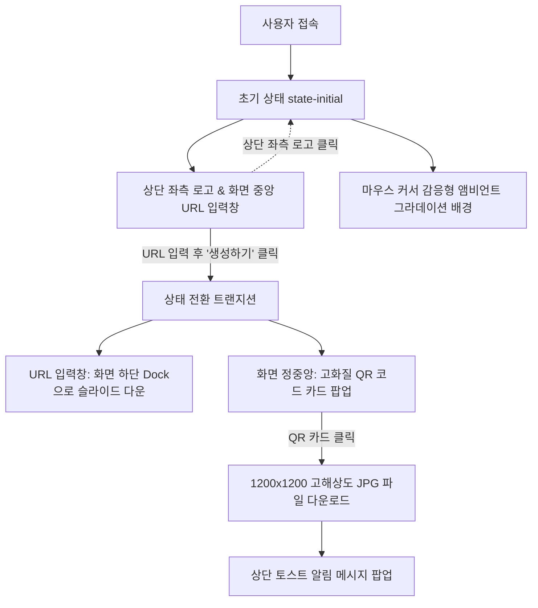

# 📋 URL2QR 구현 계획서 (Implementation Plan)

## 1. 프로젝트 개요
- **프로젝트 명**: URL2QR (빠르고 간편한 인터랙티브 QR 코드 생성 웹 애플리케이션)
- **목적**: 사용자가 웹 URL을 입력하면 즉시 중앙에 고화질 QR 코드를 생성하고, 클릭 한 번으로 인쇄 및 디지털용 고화질 JPG 파일로 내려받을 수 있는 인터랙티브 웹 서비스 구축.
- **핵심 기술 스택**: 
  - **HTML5**: 시맨틱 웹 구조 및 Canvas 렌더링
  - **Vanilla CSS**: 최신 글래스모피즘, 앰비언트 그라데이션, `cubic-bezier` 애니메이션
  - **Vanilla JavaScript**: `qrcode-generator` 라이브러리 연동, Lerp 기반 60fps 마우스 트래커, 고해상도 JPG 다운로드 파이프라인

---

## 2. 시스템 아키텍처 & 레이아웃 구조

---

## 3. 핵심 모듈별 구현 세부 계획

### 3.1 브랜드 아이덴티티 및 상단 헤더
- **위치**: 화면 상단 좌측 고정 ([index.html](file:///c:/Users/SON/바이브코딩/프로젝트04/index.html))
- **로고 이미지**: [img/logo.png](file:///c:/Users/SON/바이브코딩/프로젝트04/img/logo.png) (노란색 바탕의 볼드 타이포그래피)
- **인터랙션**:
  - 로고 클릭 시 페이지를 새로고침하지 않고도 부드럽게 초기 상태(`state-initial`)로 리셋.
  - 우측에 은은한 펄스 점이 포함된 `Instant QR Generator` 상태 뱃지 배치.

### 3.2 마우스 반응형 다이내믹 그라데이션 (Light & Warm Theme)
- **배경 톤**: 로고와 어우러지는 따스한 샴페인 아이보리(`--bg-base: #FAF8F3`) 및 웜 앰버 골드(`--accent-gold: #F59E0B`).
- **인터랙티브 레이어**:
  1. `base-gradient`: 파스텔 톤(옐로우/선샤인, 피치, 아이보리) 기본 배경.
  2. `dynamic-mesh`: 마우스 커서의 X, Y 좌표에 따라 방사형 그라데이션의 중심점이 이동하며 `hue-rotate` 색조가 -25deg ~ +25deg 사이로 자연스럽게 변화.
  3. `cursor-spotlight`: 마우스 커서 바로 밑에 480px 크기의 소프트한 빛의 오라(Aura)가 따라다님.
  4. `ambient-orbs`: 부유하는 3개의 블러 원형 레이어가 배경에 깊이감 부여.
- **성능 최적화**: `requestAnimationFrame`과 Lerp(선형 보간, 0.08) 계수를 적용하여 프레임 드랍 없는 60fps 무빙 보장.

### 3.3 입력 독(URL Input Dock)의 부드러운 위치 전환
- **초기 상태 (`state-initial`)**:
  - `top: 50%`, `transform: translate(-50%, -50%)`로 화면 정중앙에 위치.
  - 상단에 안내 문구(Hero Section)가 표시됨.
- **생성 완료 상태 (`state-generated`)**:
  - `top: calc(100% - 66px)`로 화면 최하단 플로팅 독으로 슬라이드 다운.
  - 안내 문구는 부드럽게 위로 페이드아웃.
  - `transition: all 0.65s cubic-bezier(0.16, 1, 0.3, 1)` 적용으로 부드러운 스프링 모션 구현.

### 3.4 강력한 QR 생성 엔진 & 고해상도 JPG 다운로드
- **엔진**: [js/qrcode.min.js](file:///c:/Users/SON/바이브코딩/프로젝트04/js/qrcode.min.js) (`qrcode-generator`)
  - `typeNumber: 0`을 지정하여 텍스트 길이에 따라 QR 버전(1~40) 자동 감지.
  - 한글, 특수문자 `UTF-8` 완전 지원.
  - 에러 정정 레벨 자동 폴백 알고리즘 (`H` → `Q` → `M` → `L`).
- **화면 렌더링**: 512px 레티나 디스플레이용 Canvas로 중앙에 렌더링.
- **다운로드 파이프라인**:
  - QR 카드 클릭 시 별도의 1200×1200 고해상도 캔버스 생성.
  - 순백색 바탕(`fillStyle = '#ffffff'`) 채움 (JPG 배경 투명화/블랙 버그 방지).
  - 120px 안심 여백(Quiet Zone)과 함께 모듈 단위 정밀 드로잉.
  - `canvas.toDataURL('image/jpeg', 0.95)`를 통해 `qrcode_[domain].jpg`로 자동 다운로드 트리거.
  - 토스트 알림창 3초간 노출.
